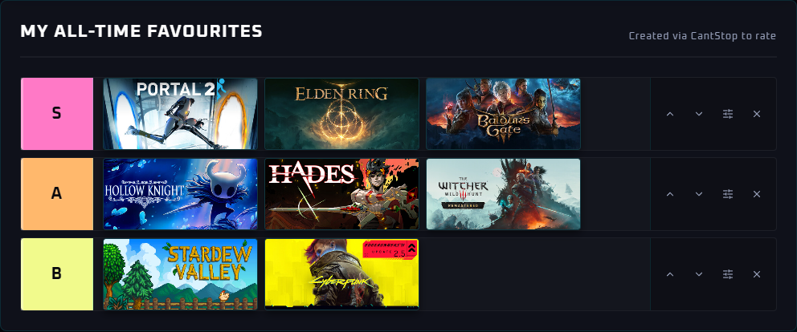

# CStoRate — Steam game tier list maker

Rank your Steam games, save multiple tier lists in your browser, and share a link or export your board as a PNG.

**[Open tier list maker](https://wallert.github.io/CStoRate/)**



---

## ✨ Features

- **Steam Search & Fast Import:** Search games by name or paste Steam store links / App IDs directly.
- **Drag & Drop:** Move games between tiers, reorder them within a row, or drag to the trash bin to delete.
- **Mobile Controls:** Swipe over cards to scroll, hold a card for 450 ms to drag, or tap it to choose a tier. Mouse dragging and keyboard controls are also available.
- **Compact Phone Settings:** List Info, Add Games and Actions start collapsed on phone-width screens. Tap a heading to open it; list search stays visible. Desktop panels stay open.
- **Card Styles:** Switch between horizontal banners and vertical posters, with adjustable card sizes.
- **PNG & JSON Export:** Save high-resolution images of your tier lists or export your config to JSON.
- **Auto-Save:** Saves your progress locally in your browser so you don't lose your work.

---

## 💻 How to Run Locally

For the best search experience (and to bypass browser CORS limits on Steam API), run it locally:

1. Clone or download this repository.
2. Install Node.js 20.19+ on the 20.x line, 22.12+ on the 22.x line, or 24+. Run **`start.bat`** (Windows) or start the included local server:
   ```bash
   npm run dev
   ```
3. Open `http://127.0.0.1:8080` in your browser. The server binds only to loopback and serves only the website assets and two fixed Steam API endpoints; no extra server package is downloaded.

---

## 🛠️ Built With

- Plain HTML5, CSS3 & JavaScript (Vanilla JS, no heavy frameworks)
- [Lucide Icons](https://lucide.dev/)
- [html2canvas](https://html2canvas.hertzen.com/) for PNG image generation

## Local data and recovery

Autosave and My Library live in this browser profile and website origin. The status underneath the board controls shows whether the latest changes were saved, including when Actions is collapsed. If browser storage is blocked or full, open **Actions → Save JSON** before closing the tab.

Loading JSON, a share link, a saved list, or Reset All preserves one previous board. Use **Restore previous board** to recover it, including after reload. This is one recovery slot, not a full undo history. JSON is the portable backup between localhost, GitHub Pages and other browsers.

Boards support up to **50 tiers / 1000 games**. JSON imports are limited to **5 MiB** and combined image strings to **3 MiB**. Share links support up to **500,000 encoded characters**. Use JSON for larger boards.

## Quality checks

```bash
npm ci
npm run check
```

The check command validates JavaScript syntax and runs offline DOM integration/regression tests, stress tests, and HTTP tests for the local server. Tests close their browser environments and return failing exit codes.

## Deployment

In GitHub, open **Settings → Pages**, select **Deploy from a branch**, then choose **main** and **/ (root)**. GitHub Pages serves `index.html`, `style.css` and `app.js` directly. Check the deployment in the repository’s Actions tab and the version in the live site’s footer.

The local Node.js server proxies Steam requests during development. On GitHub Pages, the app uses Jina Reader and falls back to AllOrigins. If a provider is unavailable or rate-limited, use **Retry search**.

On a host with your own Steam proxy, add `<meta name="steam-proxy" content="/steam-api/">` to `index.html`. Serve `/steam-api/storesearch/` and `/steam-api/appdetails/` on the same origin. Restrict upstream requests to Steam and enforce query validation, response size limits and timeouts.

## Releases

Current version **1.0.7**. See [GitHub Releases](https://github.com/Wallert/CStoRate/releases) for tagged versions and [release notes](RELEASE_NOTES.md) for the full history.

---

## 📜 License

Distributed under the [MIT License](LICENSE).
